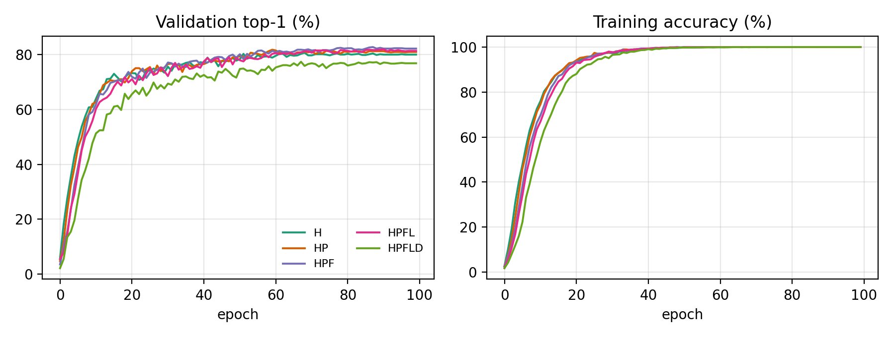
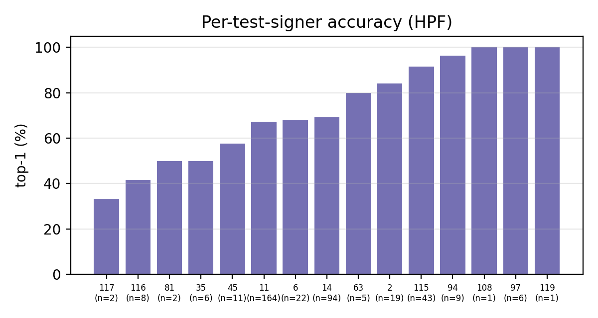
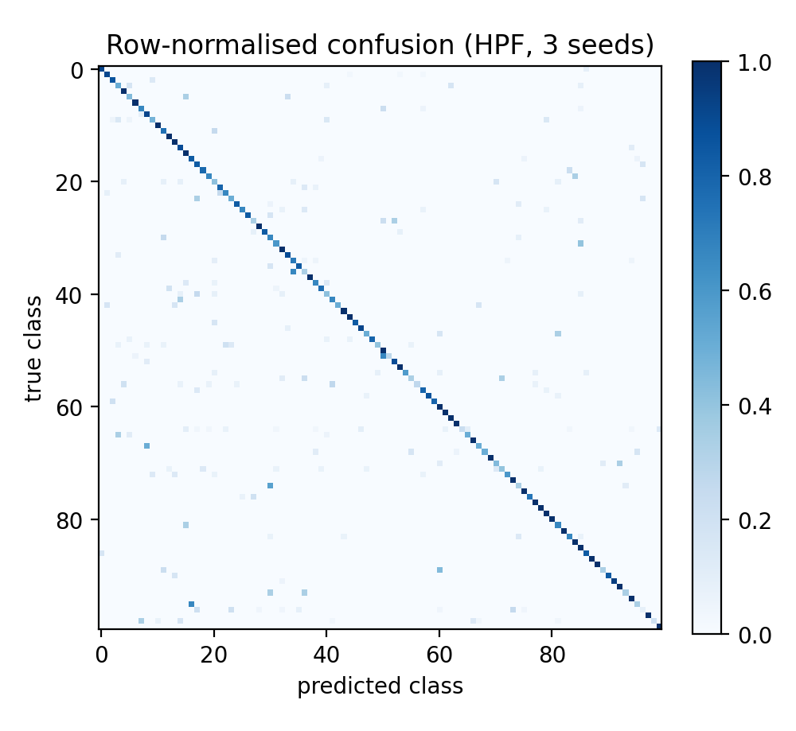

# Which Cues Matter? A Modality-Wise Study of Isolated Sign Recognition on WLASL


Code, run logs, and figures for a controlled study of which visual cues matter for
word-level American Sign Language (ASL) recognition. Developed as the final project for
COMP 4471 / ELEC 4240 at The Hong Kong University of Science and Technology.

**Authors:** Anas Boutor, Baiel Abdykerimov

## TL;DR

- Each cue (hands, pose, eyes and eyebrows, lips, MediaPipe depth) is a separate stream in a
  modular transformer over MediaPipe Holistic landmarks, so cues can be added or removed
  without changing the temporal model.
- Evaluation is on **WLASL100 with a signer-independent split we construct ourselves**,
  because the official splits share signers between train and test.
- On unseen signers, **hands alone reach 70.2 ± 0.4% top-1**. Adding pose, eyes and
  eyebrows, or lips changes this by less than seed noise (71.0, 71.4, 70.4%).
- Adding MediaPipe's estimated z coordinate **hurts by about 6 points** (65.6 ± 0.5%).
- Evaluating on the official split (signers overlap) inflates top-1 by **8.3 points**
  (79.7 ± 1.6% vs 71.4 ± 2.1%).

## Results

All transformer numbers are mean ± sample std over 3 seeds on the signer-independent
test set (393 clips, 15 signers). Baselines are single runs (seed 0).

### Modality ablation (T = 32 frames)

| Modalities | Top-1 (%) | Class top-1 (%) | Top-5 (%) | Val top-1 (%) |
|---|---|---|---|---|
| H | 70.2 ± 0.4 | 74.8 ± 0.8 | 86.1 ± 0.4 | 81.5 |
| H + P | 71.0 ± 1.0 | 75.6 ± 1.4 | 87.4 ± 0.4 | 82.4 |
| H + P + F | 71.4 ± 2.1 | 75.1 ± 2.0 | 86.3 ± 2.1 | **82.9** |
| H + P + F + L | 70.4 ± 0.6 | 75.2 ± 1.4 | 86.3 ± 0.8 | 82.7 |
| H + P + F + L + D | 65.6 ± 0.5 | 70.8 ± 0.8 | 85.4 ± 0.4 | 78.1 |

H: hands, P: pose, F: eyes and eyebrows, L: lips, D: MediaPipe relative z (monocular
estimate, not measured depth). H + P + F is selected on validation accuracy only. Only the
drop from adding D exceeds seed noise.

### Model comparison

| Model | Input | Top-1 (%) | Top-5 (%) | Params (M) | Train (s) | Infer. (ms/clip) |
|---|---|---|---|---|---|---|
| **Transformer (ours)** | landmarks (H+P+F) | **71.4 ± 2.1** | 86.3 ± 2.1 | 3.45 | 116 | 2.1 |
| BiLSTM | landmarks (H+P+F) | 60.8 | 81.9 | 2.94 | 96 | 2.6 |
| Pose-TGCN (re-implementation) | pose + hands (x, y) | 53.9 | 77.6 | 1.19 | 75 | 2.3 |
| ResNet-18 | skeleton images | 51.7 | 73.0 | 11.2 | 470 | 3.1 |
| I3D (`i3d_r50`, Kinetics-400) | RGB | 50.9 | 74.8 | 27.4 | 3,592 | 55.3 |
| ViT-B/16 | skeleton images | 47.8 | 71.8 | 85.9 | 580 | 17.2 |

Inference is per clip at batch size 1 on an NVIDIA T4. Published I3D (65.89%) and
Pose-TGCN (55.43%) numbers on the official split use signer-dependent test data and
different keypoints, so they are not comparable and are not shown here.

### Number of input frames (H+P+F, seed 0 only)

| T | Top-1 (%) | Infer. (ms) | Train (s) |
|---|---|---|---|
| 8 | 70.2 | 1.5 | 96 |
| 16 | 71.0 | 1.9 | 101 |
| 32 | 73.8 | 2.1 | 116 |
| 64 | 69.2 | 1.7 | 161 |

Seed 0 is the best of the three T = 32 seeds (3-seed mean 71.4%), so differences between
8, 16 and 32 frames are within seed noise. We use T = 32.

### Signer-dependent vs signer-independent (H+P+F, 3 seeds)

| Split | Top-1 (%) | Top-5 (%) |
|---|---|---|
| Official WLASL100 (signers overlap) | 79.7 ± 1.6 | 93.3 ± 0.8 |
| Ours (signer-independent) | 71.4 ± 2.1 | 86.3 ± 2.1 |
| Gap | +8.3 | +7.0 |

### Training behaviour



All modality sets reach 100% training accuracy by about epoch 50, while validation top-1
plateaus around epochs 40 to 45 and stays flat to epoch 100 (final validation: H 80.0,
HP 80.9, HPF 82.2, HPFL 81.3, HPFLD 76.8). The depth variant converges more slowly and
plateaus lower.

### Per-signer accuracy



Per-signer top-1 (H+P+F) ranges from 33.3% to 100%. One signer (ID 11) supplies 164 of
the 393 test clips (42%) and scores 67.3%, so the aggregate is dominated by one signer.
Among the 11 signers with at least 5 test clips, the range is 41.7% to 100% and does not
shrink when cues are added (range: H 54.6, HP 62.5, HPF 58.3, HPFL 62.5, HPFLD 55.6 points).

### Error analysis



Errors are spread thinly across many classes. 34 of 100 glosses are correct in every test
clip of every seed. The hardest are *same* (8%), *tell* (20%), *give* (23%), *corn* (27%)
and *accident* (28%). The most frequent confusions are accident→wrong, tell→who,
woman→full, last→before, right→year and same→time. Clips where both hands are missing in
more than 40% of frames score 65.7% top-1, against 72.7% on the rest.

## Data and split

- **Dataset:** WLASL100, all 2,038 videos from 97 signers, obtained from the Kaggle mirror
  `gazquez/wlasl-processed` (the more common `risangbaskoro/wlasl-processed` mirror
  contains only 1,013 of these 2,038). Clips are 256×256, 25 fps, median 59 frames, and
  are already trimmed to the sign, so each clip is used whole.
- **Signer-independent split** (`build_metadata.py`, seed 0), with no signer shared across
  splits and all 100 glosses present in every split:

| Split | Videos | Signers | Glosses |
|---|---|---|---|
| Train | 1,402 | 72 | 100 |
| Validation | 243 | 10 | 100 |
| Test | 393 | 15 | 100 |

- **Landmark quality:** 770 of 2,038 clips (37.8%) have both hands missing in more than
  40% of frames; none are removed. Upscaling frames 2× or 3× before MediaPipe did not change
  the missing rate, so low resolution is not the cause. We did not inspect frames to
  confirm the real cause.

The WLASL data are not redistributed here. Follow the dataset's own license and terms.

## Method in brief

1. **Landmarks.** MediaPipe Holistic per frame: hands (2 × 21), upper-body pose (25), eyes
   and eyebrows (52 face-mesh points), lips (40 face-mesh points).
2. **Normalization.** Subtract the per-frame shoulder midpoint, divide by the median
   shoulder width over the clip, interpolate missing detections along time, resample to
   T = 32 frames.
3. **Model.** Each stream is linearly projected, concatenated, mixed per frame, and passed
   to a 4-layer transformer encoder (8 heads, d = 256) with a class token. Parameters: 3.28M
   (H), 3.45M (H+P+F), 3.58M (all five streams).
4. **Training.** AdamW (weight decay 0.05, lr 3e-4), 5 warm-up epochs then cosine decay,
   batch size 32, 100 epochs, label smoothing 0.1, gradient clipping 1.0. Augmentation:
   rotation (±15°), scaling (0.9 to 1.1), temporal cropping (80 to 100%), and per-stream
   frame dropout (p = 0.1). The checkpoint with the best validation top-1 is evaluated on
   test.

## Repository layout

```
.
├── fetch_wlasl100.py     # download the 2,038 WLASL100 videos (resumable)
├── build_metadata.py     # signer-independent split -> data/split.csv
├── extract.py            # MediaPipe Holistic landmark extraction
├── check_landmarks.py    # visual sanity check of landmarks on one frame
├── data_stats.py         # landmark-quality statistics (missing-hand flags)
├── dataset.py            # normalization, augmentation, modality selection, skeleton renderer
├── model.py              # modular transformer, BiLSTM, Pose-TGCN, CNN/ViT, I3D
├── train.py              # train one configuration, evaluate best-val checkpoint
├── run_all.py            # full experiment plan (resumable)
├── aggregate.py          # tables: mean ± std over seeds
├── figs.py               # training curves, confusion matrix, per-signer plot
├── config.py             # paths (override with WLASL_ROOT / WLASL_RAW)
├── mp_constants.py       # frozen MediaPipe index lists
├── COLAB.md              # running the experiments on Colab T4s
└── runs/                 # all experiment outputs (see below)
```

### `runs/` contents

| Path | Description |
|---|---|
| `runs/<model>_<mods>_T<T>_s<seed>[_official]/` | One folder per run (26 total), see below |
| `runs/results.csv` | Transformer ablation runs: val and test metrics, best epoch, params, train time |
| `runs/summary_per_run.csv` | All 26 runs in one table (model, modalities, T, seed, split, metrics, timing) |
| `runs/aggregate_output.txt` | Raw output of `python aggregate.py` (all tables above) |
| `runs/report_numbers.md` | Final numbers used in the report |
| `runs/extract_log.csv` | Per-video landmark extraction status, frames and time |
| `runs/figs/` | `fig2_training_curves.png`, `fig3_confusion.png`, `fig4_per_signer.png`, `figs_summary.txt` |

Each run folder contains:

| File | Description |
|---|---|
| `config.json` | Hyperparameters, seed, split, device, git commit |
| `metrics.json` | Top-1/top-5 (instance and per class), val top-1, best epoch, params, train time, inference ms/clip |
| `log.csv` | Per-epoch train loss and accuracy, validation top-1 and loss |
| `test_preds.csv` | Per-video predictions (`video_id, signer_id, gloss, label, pred, top5`) |

Run names encode the setup, for example `transformer_HPF_T32_s1_official` is the
H+P+F transformer, 32 frames, seed 1, on the official split. Baselines are
`lstm_HPF_T32_s0`, `tgcn_HP_T32_s0`, `cnn_HP_T32_s0`, `vit_HP_T32_s0` and `i3d_RGB_T32_s0`.

## Reproducing the results

### Setup

Python 3.10+ and a CUDA GPU (a single Colab T4 is enough).

```bash
git clone https://github.com/baiyelll/modality-wise-sign-recognition-wlasl.git
cd modality-wise-sign-recognition-wlasl
pip install torch torchvision numpy pandas opencv-python mediapipe==0.10.14 tqdm fvcore iopath
```

`fvcore` and `iopath` are only needed for I3D, which loads `i3d_r50` through `torch.hub`
on first use. The CNN and ViT baselines download ImageNet weights on first use.

### Data pipeline

```bash
python fetch_wlasl100.py      # needs WLASL_v0.3.json and nslt_100.json (see script header)
python build_metadata.py      # builds data/split.csv
python extract.py             # landmarks (resumable; --workers N)
python data_stats.py          # missing-hand statistics
```

### Experiments

```bash
python run_all.py --phase ablation   # H, HP, HPF, HPFL, HPFLD x 3 seeds
python run_all.py --phase split      # official split, best modalities x 3 seeds
python run_all.py --phase frames     # T = 8, 16, 64
python run_all.py --phase lstm       # BiLSTM
python run_all.py --phase skel       # skeleton-image CNN and ViT
python run_all.py --phase tgcn       # Pose-TGCN
python run_all.py --phase i3d        # I3D on RGB
python aggregate.py                  # prints tables, writes runs/summary_per_run.csv
python figs.py                       # regenerates runs/figs/
```

Single run:

```bash
python train.py --model transformer --mods HPF --T 32 --seed 0 [--split official]
```

Sanity checks: `--overfit` should reach about 100% training accuracy, and
`--shuffle_labels` should score at chance. Finished runs (those with a `metrics.json`) are
skipped, so an interrupted session can be resumed. Use `--dry` to print the commands only.
Estimated T4 time for the full plan: about 8 to 12 hours, dominated by I3D (about 1 hour).
See [COLAB.md](COLAB.md) for a two-person Colab workflow.

## Limitations

- Baselines (BiLSTM, Pose-TGCN, skeleton-image CNN/ViT, I3D) and the frame-count study are
  single runs, so the 8.3-point split gap and the ranking among baselines carry that
  uncertainty. The 10-point gap to the transformer is much larger than its seed spread.
- The test set has 15 signers, but one provides 42% of the clips, so per-signer results are
  noisy.
- Hand landmarks are missing in over 40% of frames for 37.8% of clips, and the cause was
  not verified.
- The depth cue is MediaPipe's relative z, not a dedicated depth model, so the negative
  result does not apply to better depth estimates.
- No leave-one-out ablation was run, so interactions between modalities that the
  add-one-at-a-time order hides cannot be excluded.
- Only WLASL100 was evaluated, from one dataset mirror and one split construction (seed 0).

## Citation

If you use this code or results, please cite:

```bibtex
@misc{boutor2026whichcues,
  title        = {Which Cues Matter? A Modality-Wise Study of Isolated Sign Recognition on WLASL},
  author       = {Boutor, Anas and Abdykerimov, Baiel},
  year         = {2026},
  note         = {COMP4471 / ELEC4240 final report, The Hong Kong University of Science and Technology},
  eprint       = {TODO},
  archivePrefix= {arXiv},
  primaryClass = {cs.CV}
}
```

## References

- D. Li, C. Rodriguez, X. Yu, H. Li. *Word-level deep sign language recognition from video:
  a new large-scale dataset and methods comparison.* WACV 2020.
- C. Lugaresi et al. *MediaPipe: A framework for building perception pipelines.*
  arXiv:1906.08172, 2019.
- J. Carreira, A. Zisserman. *Quo vadis, action recognition? A new model and the Kinetics
  dataset.* CVPR 2017.

## License

TODO: add a `LICENSE` file (MIT or Apache-2.0 are common for research code). Dataset
licensing follows WLASL and the Kaggle mirror's terms.

## Acknowledgments

TODO: acknowledge supervision or feedback if Prof. Qifeng Chen agrees. Experiments ran on
free Google Colab T4 GPUs.
